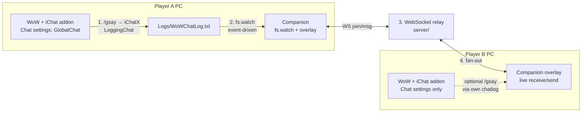
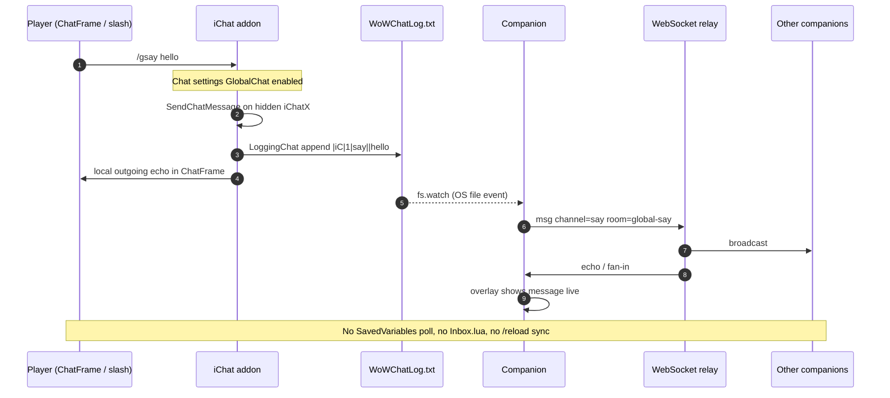

# iChat — Stage 1 realtime GlobalChat

Cross-region chat for World of Warcraft. Players configure **GlobalChat** types in normal Chat settings and talk with `/gsay`, `/gtrade`, `/gcity`, `/groom`, `/gwhisper`. Live traffic uses a **local companion** + **WebSocket relay** — **not** timed SavedVariables / Inbox / `/reload` sync loops.

Realtime transport landed in [PR #2](https://github.com/OldCodmasters/iChat/pull/2) (merged). This tree’s docs match that architecture.

## Methodology / Architecture

**Why a companion exists:** WoW addon Lua is sandboxed — no sockets, HTTP, or WebSockets. Cross-region chat cannot ride Blizzard’s realm chat. A local companion process bridges the game to a WebSocket relay.

**How players use it:** GlobalChat types live in normal **Chat settings** (not a standalone messenger). Send with `/gsay`, `/gtrade`, `/gcity`, `/groom`, `/gwhisper`. **Live receive** is the companion **overlay** (ChatFrame cannot be pushed inbound messages without `/reload` or process injection).

**What we refuse:** timed SavedVariables / Inbox / `/ichat sync` / poll-every-N-seconds loops. Outbound from the game is **event-driven** (`fs.watch` on the chat log). Overlay ↔ relay is always-connected WebSocket.

### End-to-end realtime flow



*Caption: Send path is game → chatlog → companion watch → relay. Receive path is relay → companion **overlay** (not ChatFrame injection). Same on every region/PC.*

### Sequence (one Global Say)



### Components

```text
┌─────────────────────────────────────────────────────────────────────────┐
│                         Stage 1 methodology                             │
├───────────────┬─────────────────────────────┬───────────────────────────┤
│  WoW client   │  Local companion (required) │  Relay (shared)           │
│  addon/iChat  │  companion/                 │  server/                  │
├───────────────┼─────────────────────────────┼───────────────────────────┤
│ Chat settings │ fs.watch WoWChatLog.txt     │ WebSocket rooms           │
│ GlobalChat    │ always-on overlay UI        │ global-say / trade / …    │
│ /gsay … slash │ WS client ↔ relay           │ whisper target filter     │
│ LoggingChat + │ NO SavedVariables poll      │                           │
│ iChatX bridge │                             │                           │
│ IChatDB=prefs │ Live RECEIVE surface        │                           │
│ only          │                             │                           │
└───────────────┴─────────────────────────────┴───────────────────────────┘
        │ chatlog append              │ WS                    │
        └─────────────────────────────┴────────────────────────┘
```

| Piece | Role |
| --- | --- |
| [`addon/iChat`](addon/iChat) | GlobalChat Chat settings + slash cmds; enables chat logging; emits bridge lines; outgoing ChatFrame echo |
| [`companion/`](companion) | **`fs.watch` chatlog** + always-connected **overlay** at `http://127.0.0.1:7712` |
| [`server/`](server) | Minimal WebSocket room relay |

### What is *not* the transport path

- No SavedVariables outbox polling
- No `Inbox.lua` reload loop
- No `/ichat sync` product step
- No “every N seconds” UX

`IChatDB` (addon SavedVariables) stores **Chat settings prefs only** (which GlobalChat types are enabled per window, colors, default room name). It is **not** used to move chat messages.

### Honest ChatFrame limit

The WoW Lua sandbox **cannot** be pushed new messages from outside without login/`/reload` or process injection. Therefore:

- **Live receive** = companion **GlobalChat overlay** (WebSocket).
- **In-game ChatFrame** shows your **outgoing** GlobalChat echo (and settings toggles/colors). It does **not** get live cross-region inbound without injection.
- Some clients **buffer** `WoWChatLog.txt`; in-game outbound may wait on Blizzard’s flush. Overlay send/receive stays sub-second.

## Install & run

Needs **Node.js 18+**.

### 1. Relay

```bash
cd server
npm install
npm start
# ws://127.0.0.1:7711
# health: http://127.0.0.1:7711/health
```

### 2. Companion (overlay + chatlog watch)

```bash
cd companion
cp config.example.json config.json
# Edit config.json:
#   "sender": "YourName-YourRealm"
#   "wowChatLogPath": "C:/Program Files (x86)/World of Warcraft/_retail_/Logs/WoWChatLog.txt"
#   (Classic: .../_classic_era_/Logs/WoWChatLog.txt or .../_classic_/Logs/...)
npm install
npm start
# overlay: http://127.0.0.1:7712
# health:  http://127.0.0.1:7712/api/health  → polling: false
```

Leave the companion running while you play. Open the overlay for live chat.

### 3. Addon

1. Copy `addon/iChat` → `World of Warcraft/_retail_/Interface/AddOns/iChat`  
   (or `_classic_era_` / `_classic_` for Classic).
2. Enable **iChat** at character select.
3. In-game: Chat settings → **GlobalChat** — enable Global Whisper / Room / Say / Trade / City on the tabs you want.
4. Send: `/gsay hello`, `/gtrade …`, `/gcity …`, `/groom [name] …`, `/gwhisper Player-Realm …`  
   Short aliases: `/gs` `/gt` `/gci` `/gr` `/gw`.
5. Read live replies in the **companion overlay**.

`/ichat help` prints commands. `/ichat room <name>` sets the default Global Room.  
`/ichat sync` is **removed** (prints a notice if typed).

## Smoke without WoW

```bash
# terminals: server + companion (wowChatLogPath can be /tmp/WoWChatLog.txt)
curl -s -X POST http://127.0.0.1:7712/api/debug/inject-chatlog \
  -H 'content-type: application/json' \
  -d '{"channel":"say","text":"hello from chatlog","sender":"Amin-Realm"}'
```

That appends a fake bridge line; `fs.watch` should relay it. Overlay WebSocket chat should also work with two browser tabs.

## Slash / channels

| Chat settings | Slash | Relay room |
| --- | --- | --- |
| Global Whisper | `/gwhisper Player-Realm msg` | `whisper` (+ target) |
| Global Room | `/groom [name] msg` | `room:<name>` |
| Global Say | `/gsay msg` | `global-say` |
| Global Trade | `/gtrade msg` | `global-trade` |
| Global City | `/gcity msg` | `global-city` |

## Targets

TOC: `## Interface: 120105, 11509, 50504` (Retail primary; Classic Era / MoP Classic secondary).

## ToS / policy

- In-game addon uses the official sandbox API.
- Companion = file watch + overlay only (no memory read/write, no input automation) — still **third-party**; residual account risk.
- Review current Blizzard EULA/ToS before distributing. Not legal advice.

## Stage 2

Discord DM bridge — **deferred**. Not implemented in this tree.

## Reviews / protected `main`

Merges to `main` must be reviewed. Code owner: **@OldCodmasters** (Amin), declared in [`.github/CODEOWNERS`](.github/CODEOWNERS).

How to add more reviewers and the **GitHub Settings clicks** to enforce required Code Owner reviews: [`CONTRIBUTING.md`](CONTRIBUTING.md).  
(Repository rulesets require admin UI; automation cannot enable them with the current token.)

## Releasing

Stage 1 ships **addon + companion + server** via GitHub Releases (not CurseForge/npm):

1. Tag `main`: `git tag -a v0.3.0 -m "iChat v0.3.0" && git push origin v0.3.0`
2. Workflow [`.github/workflows/release.yml`](.github/workflows/release.yml) attaches **`iChat-addon-<tag>.zip`** and publishes release notes for running `companion/` + `server/` from that tag.
3. Install addon from the zip; run relay + companion as in [Install & run](#install--run).

Full steps: [`docs/releasing.md`](docs/releasing.md).

## More detail

- Companion: [`companion/README.md`](companion/README.md)
- Relay: [`server/README.md`](server/README.md)
- Contributing / reviews: [`CONTRIBUTING.md`](CONTRIBUTING.md)

